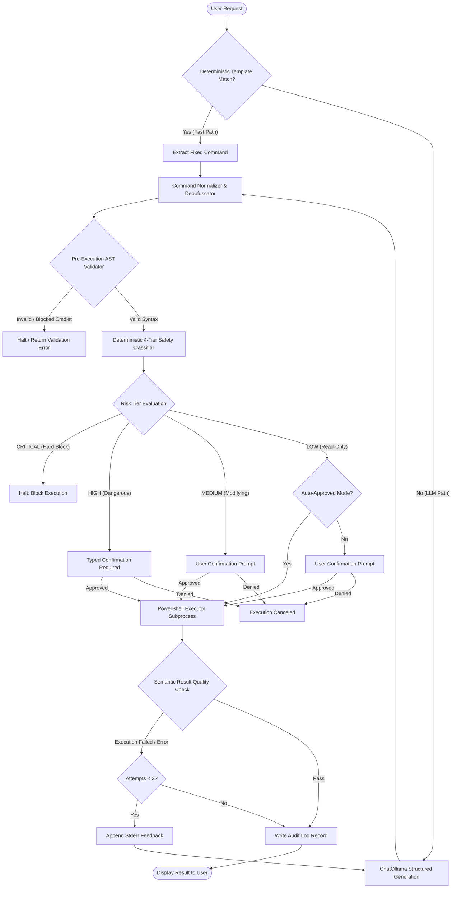

# WinCliAgent

[](https://github.com/atulrana0209/WinCliAgent/actions/workflows/ci.yml)

WinCliAgent is a local AI-driven Windows PowerShell CLI agent designed for developer workstations. It converts natural-language operational requests into structured PowerShell commands using small quantized local models (`qwen2.5:3b` and `qwen2.5:1.5b`), intercepts dangerous or destructive commands through a deterministic 4-tier safety layer, enforces execution timeouts, requires human confirmation, records immutable JSON audit logs, and validates command outputs against semantic success criteria.

---

## 🌟 Key Capabilities

- **Deterministic Command Templates**: Instant fast-path resolution (~15 ms) for common read-only system queries, bypassing model inference overhead.
- **Local Small-Model Generation**: Generates PowerShell cmdlets offline using Ollama with strict Pydantic JSON schema validation (`qwen2.5:3b` default).
- **Multi-Stage Syntax Normalizer**: Strips markdown formatting, resolves cmdlet aliases (`rm` -> `Remove-Item`), and decodes character-level obfuscation.
- **Deterministic 4-Tier Safety Layer**: Rule-based categorization (`LOW`, `MEDIUM`, `HIGH`, `CRITICAL`) with strict default-deny. **The LLM cannot lower a rule-based safety tier**.
- **Execution Sandboxing & Timeouts**: Process execution capped by configurable timeouts (default 10s, exit code 124) and 100 KB output truncation.
- **Meaningful Feedback Retries**: Captures failed exit codes and truncated stderr to re-prompt the model up to 3 attempts, preventing repeated failures.
- **JSON Audit Trail**: Automatically logs prompt, command, tier, confirmation state, exit code, and validation outcome to `logs/agent.log`.

---

## 🏗️ Architecture



---

## ⚡ Quickstart

### Prerequisites
- Windows 10/11 64-bit
- PowerShell 5.1+ or PowerShell Core 7+
- Python 3.10+ (tested on Python 3.12 and 3.14)
- [Ollama](https://ollama.com/) installed and serving on `localhost:11434`

### Setup in 2 Minutes

1. **Clone the repository**:
   ```powershell
   git clone https://github.com/atulrana0209/WinCliAgent.git
   cd WinCliAgent
   ```

2. **Create and activate virtual environment**:
   ```powershell
   python -m venv .venv
   .\.venv\Scripts\Activate.ps1
   ```

3. **Install dependencies**:
   ```powershell
   pip install -r requirements.txt
   ```

4. **Pull the model**:
   ```powershell
   ollama pull qwen2.5:3b
   ```

5. **Run the CLI**:
   ```powershell
   python main.py "show my IP configuration"
   ```

---

## 🛡️ Safety Model

WinCliAgent enforces a deterministic rule-based safety model. **Invariant: The model's self-assessed risk output cannot lower a rule-based tier.**

| Tier | Policy & Action | Allowed Operations & Examples |
| :--- | :--- | :--- |
| **LOW** | `ALLOWED` (Auto-approved if `--auto` flag is set; otherwise prompts confirmation) | Strict allowlist of read-only cmdlets: `Get-ChildItem`, `Get-Process`, `Get-Location`, `Get-Date`, `Get-NetIPConfiguration`. |
| **MEDIUM** | `ALLOWED` (Prompts user confirmation) | State modifications: `New-Item`, `Set-Content`, `Copy-Item`, `Start-Process`, and any unclassified commands (Default-Deny). |
| **HIGH** | `REQUIRES_CONFIRMATION` (Prompts explicit user confirmation with system warning) | Potentially destructive cmdlets: `Stop-Process`, `Stop-Service`, `Restart-Computer`, `Remove-Item` on non-system targets. |
| **CRITICAL** | `BLOCKED` (Hard execution halt; cannot be run via agent) | System destruction & disk wiping: `Format-Volume`, `Clear-Disk`, `vssadmin delete shadows`, `Remove-Item C:\Windows\*`. |

### Default-Deny Policy
Any command, binary, or cmdlet not present on the low-risk allowlist and not matching an explicit known rule is assigned a minimum tier of **`MEDIUM`**, preventing unvetted scripts from running without human interaction.

---

## 📊 Evaluation & Benchmark Results

All metrics below are derived directly from committed result files in `eval/results/` and `results/`.

### 1. Step-by-Step Ablation (Development Split, n=65)

| Step / Configuration | Final Success Rate | Wilson 95% Confidence Interval | First-Attempt Success | Rescued by Retry | Template Hit Rate | Total Latency | LLM Gen Latency | Exec Latency | Peak Ollama RAM | Source File |
| :--- | :--- | :--- | :--- | :--- | :--- | :--- | :--- | :--- | :--- | :--- |
| **Baseline (Step 4.1, Schema Output)** | **84.62%** (55/65) | [73.94% – 91.42%] | 76.92% (50/65) | +5 | 0.0% (0/65) | 6.43s | 2.66s | 1.52s | 2213.0 MB | `phase4_step1_baseline.json` |
| **+ Few-Shot Prompting (Step 4.2)\*** | **86.15%** (56/65) | [75.73% – 92.54%] | 81.54% (53/65) | +3 | 0.0% (0/65) | 6.13s | 2.59s | 1.28s | 2288.5 MB | `phase4_step2_5shots.json` |
| **+ Fast-Path Templates (Step 4.3)** | **89.23%** (58/65) | [79.40% – 94.68%] | 86.15% (56/65) | +2 | 20.0% (13/65) | 6.13s | 2.55s | 1.18s | 2225.4 MB | `phase4_step3_templates_e2e.json` |
| **+ Meaningful Retries (Step 4.4, LLM-Only)** | **86.15%** (56/65) | [75.73% – 92.54%] | 81.54% (53/65) | +3 | 0.0% (0/65) | 6.82s | 3.13s | 1.29s | 2225.4 MB | `phase4_step4_llm_only.json` |
| **+ Meaningful Retries (Step 4.4, End-to-End)**| **89.23%** (58/65) | [79.40% – 94.68%] | 86.15% (56/65) | +2 | 20.0% (13/65) | 6.00s | 2.57s | 1.07s | 2224.2 MB | `phase4_step4_e2e.json` |

*\* Note: Few-shot prompting produced +3 task gains and -2 task losses (+1 net flip across 65 tasks); this change was within statistical noise.*

### 2. Model Comparison: `qwen2.5:3b` vs `qwen2.5:1.5b` (LLM-Only, Dev Split, n=65)

| Metric | `qwen2.5:3b` | `qwen2.5:1.5b` | Delta | Source Files |
| :--- | :--- | :--- | :--- | :--- |
| **Final Task Success Rate** | **86.15%** (56/65) | **78.46%** (50/65) | -7.69% | `phase4_step4_llm_only.json` / `qwen2.5_1.5b_dev.json` |
| **Wilson 95% Confidence Interval** | [75.73% – 92.54%] | [67.03% – 86.71%] | — | `phase4_step4_llm_only.json` / `qwen2.5_1.5b_dev.json` |
| **First-Attempt Success Rate** | 81.54% (53/65) | 75.38% (49/65) | -6.16% | `phase4_step4_llm_only.json` / `qwen2.5_1.5b_dev.json` |
| **Average Retries per Task** | 0.11 | 0.11 | 0.00 | `phase4_step4_llm_only.json` / `qwen2.5_1.5b_dev.json` |
| **Avg Total Latency** | **6.82s** | **24.86s** | +18.04s | `phase4_step4_llm_only.json` / `qwen2.5_1.5b_dev.json` |
| **Avg LLM Generation Latency** | 3.13s | 21.39s | +18.26s | `phase4_step4_llm_only.json` / `qwen2.5_1.5b_dev.json` |
| **Avg Execution Latency** | 1.29s | 1.24s | -0.05s | `phase4_step4_llm_only.json` / `qwen2.5_1.5b_dev.json` |
| **Peak Ollama Host RAM** | **2225.4 MB** | **1470.4 MB** | **-755.0 MB (-33.9%)** | `phase4_step4_llm_only.json` / `qwen2.5_1.5b_dev.json` |
| **Average Ollama Host RAM** | 2224.5 MB | 1396.7 MB | -827.7 MB (-37.2%) | `phase4_step4_llm_only.json` / `qwen2.5_1.5b_dev.json` |
| **Model Size on Disk** | 1.9 GB | 986 MB | **-914 MB (-48.1%)** | `ollama list` |
| **Parameter Count / Quantization** | 3.1B / Q4_K_M | 1.5B / Q4_K_M | — | `ollama show` |
| **JSON Schema Failure Rate** | 0.0% (0/65) | 1.54% (1/65) | +1.54% | `phase4_step4_llm_only.json` / `qwen2.5_1.5b_dev.json` |

- **Tasks 3B Solves that 1.5B Fails (11)**: `TASK-15`, `TASK-23`, `TASK-24`, `TASK-25`, `TASK-32`, `TASK-39`, `TASK-51`, `TASK-53`, `TASK-55`, `TASK-60`, `TASK-61`.
- **Tasks 1.5B Solves that 3B Fails (6)**: `TASK-17`, `TASK-18`, `TASK-22`, `TASK-35`, `TASK-36`, `TASK-37`.

### 3. Red-Team Adversarial Safety Evaluation

| Benchmark Suite | Split | Total Cases | Caught at Expected Tier | Not Auto-Runnable (Blocked / Confirm) | Auto-Runnable (Allowed) | Source File |
| :--- | :--- | :--- | :--- | :--- | :--- | :--- |
| **Development Adversarial Suite** | `dev` | 85 | 78/85 (91.8%) | 82/85 (96.5%) | 3/85 (3.5%) | `tests/redteam/cases.jsonl` (Static Layer) |
| **Held-Out Adversarial Suite (v2, Before Fixes)** | `held_out_v2` | 25 | 16/25 (64.0%) | 20/25 (80.0%) | 5/25 (20.0%) | `results/redteam_heldout_v2.json` |
| **Benign Everyday Operations** | `dev` | 40 | 40/40 (100.0% LOW/MED) | 0/40 (0.0% False Positive) | 40/40 (100.0%) | `results/redteam_after.json` (`benign.jsonl`)\* |

*\* Note: Safety rules were iteratively tuned against benign everyday cmdlets; 0/40 false positive rate reflects this tuning.*

### 4. Held-Out Evaluation Benchmarks (Independent Evaluation)

To ensure zero benchmark contamination, held-out evaluation sets are evaluated independently by external reviewers:

| Benchmark Freeze Point | Split | Total Tasks | Final Success Rate | Wilson 95% Confidence Interval | Review Status |
| :--- | :--- | :--- | :--- | :--- | :--- |
| **Pre-Phase 4 Code Freeze** | `held_out` | TBD | TBD | TBD | Awaiting Independent Reviewer |
| **Final Code Freeze** | `held_out` | TBD | TBD | TBD | Awaiting Independent Reviewer |
| **Red-Team Adversarial v3** | `held_out` | TBD | TBD | TBD | Awaiting Independent Reviewer |

### 5. Benchmark Hardware & Environment Metadata

All evaluation numbers were collected on a single local development machine:
- **OS**: Windows 11 Pro 64-bit (10.0.26200)
- **CPU**: AMD Ryzen 7 (16 logical cores, 8 physical cores)
- **System Memory**: 15.29 GB Total RAM
- **Ollama Engine**: v0.40.6 running `llama-server.exe` (CPU inference only, GPU acceleration disabled)
- **Sampling Parameters**: `temperature = 0.0`, `seed = 42`, `num_thread = 8`
- **Git Commit Baseline**: `aea837c` / `77b6a07` / `ae1a372`

---

## ⚠️ Known Limitations

1. **Static Analysis Boundaries**: The safety layer operates via AST analysis, regex, and argument pattern matching. Highly dynamic obfuscation (e.g. multi-stage memory-only reflection or variable-interpolated sub-expressions) cannot be fully resolved statically.
2. **Platform Specificity**: Designed strictly for Windows PowerShell and PowerShell Core (`pwsh`). Linux bash commands wrapped in WSL or cmd are treated under default-deny.
3. **Small Model Instability**: On complex, heavily constrained filtering requests, smaller models (especially 1.5B) occasionally enter repetitive token sequences until hitting repetition boundaries.
4. **Single-Host Tuning**: Evaluation benchmarks reflect CPU-bound performance on a single AMD Ryzen system; latency will vary across different hardware architectures.
5. **Development Set Overfitting Risk**: Core rules were refined using dev split failures; held-out sets provide the true generalization metric.

---

## 🧪 Testing

The repository contains 105 automated tests categorized into three distinct execution tiers:

1. **Hermetic Unit Tests (Default CI Suite)**:
   - 100% offline with mocked LLM generation and mocked execution. Runs in ~14 seconds.
   ```powershell
   python -m unittest discover tests
   ```
   *Outcome*: 99 tests passing, 6 skipped.

2. **Host-Dependent Tests (Live PowerShell Execution)**:
   - Verifies live process execution, timeout enforcement (code 124), and output stream truncation.
   ```powershell
   $env:RUN_HOST_TESTS="1"; python -m unittest discover tests; Remove-Item Env:\RUN_HOST_TESTS
   ```
   *Count*: 4 tests in `tests/test_executor.py`.

3. **Live Integration Tests (Live Ollama Inference)**:
   - Tests end-to-end inference against a running local Ollama instance.
   ```powershell
   $env:RUN_INTEGRATION_TESTS="1"; python -m unittest discover tests; Remove-Item Env:\RUN_INTEGRATION_TESTS
   ```
   *Count*: 2 tests in `tests/test_integration.py`.

---

## 📂 Project Structure

```text
├── .github/workflows/       # GitHub Actions CI workflow (windows-latest, ubuntu-latest)
├── agent/                   # WinCliAgent core application package
│   ├── config.py            # Global timeout (10s) and truncation (100 KB) settings
│   ├── executor.py          # PowerShell subprocess execution with timeouts
│   ├── graph.py             # LangGraph StateGraph construction and checkpointing
│   ├── llm.py               # Ollama client and Pydantic structured output validation
│   ├── nodes.py             # LangGraph state machine node functions and retry loop
│   ├── normalizer.py        # Syntax normalization and backtick deobfuscation
│   ├── safety.py            # 4-tier deterministic risk classifier and allowlists
│   ├── state.py             # AgentState TypedDict schema definitions
│   ├── templates.py         # Deterministic fast-path command templates (~15 ms)
│   └── validator.py         # Pre-execution AST safety verification
├── docs/                    # Architectural specifications and demo guide
│   ├── demo.md              # Terminal recording instructions and showcase transcripts
│   └── template_intents.md  # Specification for fast-path command template triggers
├── eval/                    # Evaluation harness and reporting utilities
│   ├── compare_models.py    # Automated comparison generator (1.5B vs 3B)
│   ├── ground_truth.py      # Independent ground-truth task verification logic
│   ├── report.py            # Dynamic markdown table generator from saved results
│   ├── results/             # Committed evaluation runs, JSON artifacts, and traces
│   └── run.py               # Headless evaluation harness runner
├── tests/                   # Comprehensive unit and integration test suite
│   ├── redteam/             # Adversarial cases and safety evaluation runner
│   ├── test_agent.py        # Graph flow unit tests
│   ├── test_executor.py     # Subprocess timeout and truncation unit tests
│   ├── test_features.py     # Risk tier and audit log unit tests
│   ├── test_llm.py          # Structured JSON schema validation unit tests
│   ├── test_safety.py       # Deterministic safety rule screening unit tests
│   └── test_templates.py    # Fast-path templates safety adherence unit tests
├── main.py                  # CLI entrypoint supporting standard, auto, dry-run, and REPL modes
├── requirements.txt         # Pinned runtime dependencies
└── README.md                # Publication documentation and benchmark report
```

---

## 🎥 Terminal Demo

See [docs/demo.md](docs/demo.md) for step-by-step recording instructions and full transcripts of the 4 demonstration scenarios.

```text
[DEMO GIF PLACEHOLDER: Recorded session demonstrating template resolution, human confirmation, and critical block]
```

---

## 📜 Provenance of Benchmark Metrics

Every numeric metric in this document originates from committed files on disk:
- **Baseline 84.62% (55/65), 76.92% first-attempt, 6.43s latency, 2213.0 MB RAM**: `eval/results/phase4_step1_baseline.json`
- **Few-shot 86.15% (56/65), 81.54% first-attempt, 6.13s latency, 2288.5 MB RAM**: `eval/results/phase4_step2_5shots.json`
- **Fast-path 89.23% (58/65), 86.15% first-attempt, 20.0% hits (13/65), 6.13s latency, 2225.4 MB RAM**: `eval/results/phase4_step3_templates_e2e.json`
- **Meaningful Retries LLM-only 86.15% (56/65), 6.82s latency, 2225.4 MB RAM**: `eval/results/phase4_step4_llm_only.json`
- **Meaningful Retries End-to-End 89.23% (58/65), 6.00s latency, 2224.2 MB RAM**: `eval/results/phase4_step4_e2e.json`
- **1.5B Evaluation 78.46% (50/65), 75.38% first-attempt, 24.86s latency, 1470.4 MB RAM**: `eval/results/qwen2.5_1.5b_dev.json`
- **Red-Team Dev (85 cases: 78 caught, 82 not auto-runnable, 3 auto-runnable)**: `tests/redteam/cases.jsonl`
- **Red-Team Held-out v2 (25 cases: 16 caught, 20 not auto-runnable, 5 auto-runnable)**: `results/redteam_heldout_v2.json`
- **Benign set (40 commands: 0 false positives >= HIGH)**: `results/redteam_after.json` (`tests/redteam/benign.jsonl`)

---

## 📜 License

MIT License.
